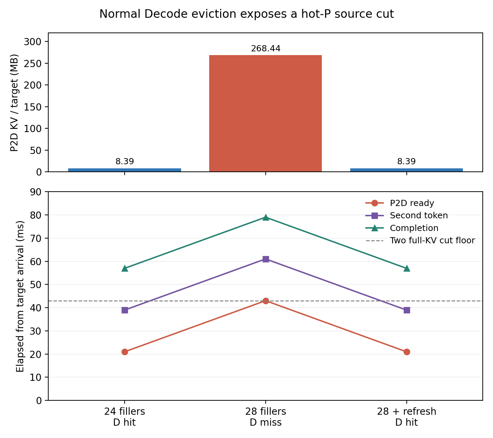
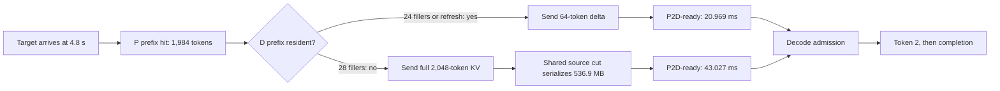

# Motivation validated: cross-role KV residency inversion

**Gate:** `MOTIVATION_VALIDATED` for a controlled, profile-backed mechanism.
**Higher gates:** `PAPER_HEADROOM_VALIDATED`, `SOLUTION_VALIDATED` and
`PAPER_READY` are **not** reached. The three motivation runs below are
frozen; their inputs, raw events/flows, manifests and analysis remain
under `candidates/r18_prefix_retention/experiments/`.

## Problem and deployment

A Prefill worker can retain a frequently reused prompt prefix while a
memory-constrained Decode worker evicts the same prefix under unrelated
requests. The next request computes only a short Prefill suffix, yet the
D miss makes the pair transfer the entire prompt KV. When multiple P
GPUs share one source NIC, this changes the modeled **P2D-ready, second
token and completion** critical path; the effect is more than an FCT
change. This is a cache-state problem, not a new scheduler benefit.

The fixture uses measured Llama-3.1-8B BF16 RTX4090 TP1/PP1 kernels; two
24-GB P GPUs share one100-Gb/s uplink and one 24-GB D GPU has its normal
0.9-utilization3,400-block KV pool. Endpoint links are200 Gb/s, the
source and destination host cuts are100 Gb/s, and the FlowSim rank map
binds each GPU to a physical endpoint. The 100-Gb/s per-server ratio has
[a published hardware precedent](https://hpc-unibe-ch.github.io/hardware/gpu/),
while the exact request stream and physical placement are controlled
assumptions. No D cache is manually cleared and no memory capacity is
reduced to force a result.

Each P first warms a **different**1,984-token prefix, also placing it on
D. Then ordinary distinct2,048-token fillers arrive in pairs300 ms apart.
Two target requests arrive together at4.8 s, each reusing its P prefix
and adding64 fresh tokens. Every earlier request finishes before the
target arrival. Targets produce3 tokens, so token2 and completion are
observable. The target prefix keys differ, eliminating same-prefix
single-flight as an explanation for the cohort.

## Theory and registered threshold

The model has32 layers,8 KV heads,128 dimensions/head and BF16 KV:

`b_KV = 2(K,V) × 32 × 8 × 128 × 2 bytes = 131,072 B/token`.

A full2,048-token handoff is268,435,456 B/request; a64-token delta is
8,388,608 B/request. Two full copies on the shared100-Gb/s source cut
need at least42.950 ms of serialization; two deltas need1.342 ms.
The measured hot-P path is about20.969 ms, and a cold2048-token Prefill
is193.161 ms. Hence hot-P plus full KV can expose the cut, whereas cold
P or D-resident delta hides its transfer.

D has3,400 blocks of16 tokens. Two warmed prefixes use2×124 blocks.
Each distinct filler adds128 cacheable prompt blocks. At24 fillers,
`2×124 + 24×128 = 3,320 < 3,400`; at28 fillers,
`2×124 + 28×128 = 3,832 > 3,400`. Each P sees at most14 fillers:
`124 + 14×128 = 1,916 < 3,400`, so P can retain its prefix while
D evicts both older keys. The first aggregate overflow occurs at25
fillers;28 was chosen to cross far enough to evict both124-block
prefixes without changing the physical pool. The prediction was written
in `candidates/r18_prefix_retention/theory/derive.py` and the experiment
plan before these runs.

## Negative control, threshold and causal ablation

All times below are elapsed from the identical4.8-s target arrival.
Each row is a pair of distinct targets; within a row their metrics agree.

| Condition | P hit / target | D pre-transfer hit / target | P2D bytes / target | Last-flow slack before ready | P2D-ready | Token 2 | Completion |
|---|---:|---:|---:|---:|---:|---:|---:|
| 24 fillers, negative control | 1,984 tokens | 1,984 tokens | 8,388,608 B | 1.630 ms | 20.969 ms | 38.970 ms | 56.971 ms |
| 28 fillers, threshold | 1,984 tokens | 0 | 268,435,456 B | 0 | 43.027 ms | 61.028 ms | 79.029 ms |
| 28 fillers + two ordinary refresh requests at4.5 s | 1,984 tokens | 1,984 tokens | 8,388,608 B | 1.630 ms | 20.969 ms | 38.970 ms | 56.971 ms |

The refresh requests perform real Prefill, P2D and Decode work, finish
before4.8 s, and restore the two D prefixes. They change D cache state
without changing the target arrival, P cache, target tokens, GPUs, NIC
or memory size. This is a **causal cache-state ablation**, not a free
retention algorithm: the refreshes themselves consume resources.

The independent analyzer checks every flow's request ID, rank, bytes,
start/end and physical path through source rail `3→5` and destination
rail `5→4`; all requests complete. It also checks that prior work has
finished, both P prefix hits stay1,984, D query changes as predicted,
no target has D capacity wait, and final flow ≤ P2D-ready ≤ D admit ≤
token2 ≤ completion. The threshold case's two targets send536,870,912 B
on the source cut; its42.950-ms serialization floor is only0.077 ms
below the43.027-ms ready event. The event chain and raw checks are in
the per-case `analysis.json`, `target_timeline.csv`, `flow_ledger.csv`,
`events.jsonl`, `flows.jsonl` and `manifest.json` files.





## Baselines, remaining optimization space and risks

The most direct strong set is block LRU/LFU, cost-aware cache admission,
cache-aware Decode routing, pinned delta handoff, same-prefix single-flight
and their simple composition. The current simulator already uses a
vLLM-like block free-list order and DELTA. There is only one D in this
fixture, so routing cannot repair its miss; adding another D without
matching resources is not an algorithm comparison. The D-hit branch is
an **ideal cache-state Oracle**, not achieved policy gain. Because all
warm keys and fillers have only one prior appearance, the fixture has
no online signal that tells an admissible policy which keys will recur.
Therefore the measured22.058-ms target completion difference does **not**
validate any incremental benefit over LFU, PrefixPlace-like retention or
NetKV-like cache/load/network routing. Closest work includes
[PrefixPlace](https://arxiv.org/abs/2608.01655) and
[NetKV](https://arxiv.org/abs/2606.03910); any solution must define a
new lawful signal or joint decision and beat their simple combination.

An additional [online cache decision screen](candidates/r18_prefix_retention/theory/online_baseline_screen.json)
replays the same prefix identities and3,400-block capacity without
claiming Serving latency. With the frozen one-access history, LRU, LFU
and simple cost-weighted LFU all miss both targets, while a
future-knowing Oracle retains them. In an **analytic counterfactual**
with one extra earlier access to each warm prefix, plain LFU already
retains both. Thus the current fixture supplies neither a lawful
predictive feature nor an unsolved LFU case. This screen is separate
from the frozen simulator runs.

Production frequency of this exact short-output/reuse/churn motif is
unverified. The committed ShareGPT traces had only32/300 requests with
any earlier block-level prefix reuse; earlier public Qwen screening did
not justify an eight-prefix burst. FlowSim is fluid and omits packet
congestion, NIXL startup/control timing and client egress. Destination
query and D capacity credit are zero simulated ns. The simulator's first
visible token is a graph-completion proxy, so this report uses P2D-ready,
token2 and modeled request completion rather than client TTFT/TBT.

## Reproduction

From `/home/dell/lpm/LLMServingSim`:

```bash
/home/lpm/.conda/envs/llmsim-flowsim/bin/python research_autonomous/candidates/r18_prefix_retention/experiments/run.py --fillers 24 --tag reproduce
/home/lpm/.conda/envs/llmsim-flowsim/bin/python research_autonomous/candidates/r18_prefix_retention/experiments/run.py --fillers 28 --tag reproduce
/home/lpm/.conda/envs/llmsim-flowsim/bin/python research_autonomous/candidates/r18_prefix_retention/experiments/run.py --fillers 28 --refresh --tag reproduce
/home/lpm/.conda/envs/llmsim-flowsim/bin/python research_autonomous/candidates/r18_prefix_retention/experiments/analyze.py research_autonomous/candidates/r18_prefix_retention/experiments/filler_24_reproduce
/home/lpm/.conda/envs/llmsim-flowsim/bin/python research_autonomous/candidates/r18_prefix_retention/experiments/analyze.py research_autonomous/candidates/r18_prefix_retention/experiments/filler_28_reproduce
/home/lpm/.conda/envs/llmsim-flowsim/bin/python research_autonomous/candidates/r18_prefix_retention/experiments/analyze.py research_autonomous/candidates/r18_prefix_retention/experiments/filler_28_refresh_reproduce
MPLCONFIGDIR=/tmp/llmservingsim-mpl /usr/bin/python3 research_autonomous/plot_r18_motivation.py
```

Use a new `--tag` for each reproduction; runners refuse to overwrite any
case directory. Each manifest
records git HEAD, tracked diff digest, source/config/profile hashes,
Python/package versions, exact command, seed and physical mapping. To
reproduce afresh, use a fresh tag or an isolated worktree; retain the
frozen data. The next research stage is online retention
signal and strong-baseline/Oracle comparison on legal same-resource
placement choices. No large-scale trace validation is justified yet.
